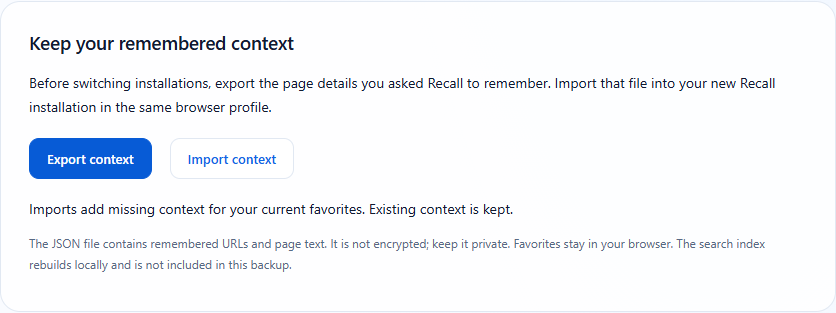

# Recall · Automatic updates through Edge Add-ons

**A Novalon app**

**Status: being prepared.** Recall's Edge Add-ons submission package and migration tools are ready for publisher registration and Microsoft review. There is no verified live store listing yet. The GitHub ZIP still uses manual updates.

## What will change

After Recall is approved and installed from Microsoft Edge Add-ons, Edge will download and install approved updates itself. You will no longer need to download a ZIP or replace files for that installation. Updates follow Microsoft's review and browser delivery schedule; publishing a GitHub release does not immediately update the store edition.

We will add the verified store link here when it is available. Until then, keep your current Recall installation.

## Prepare your existing installation

1. Update your existing unpacked Recall to **0.1.4** in place. Keep its current folder and use **Reload**, not Remove. [Instructions](UPDATING.md).
2. Open Recall → **ⓘ About** → **Export context**.
3. Keep the downloaded `Recall-context-YYYY-MM-DD.json` file somewhere private. It contains the URLs and page details you explicitly asked Recall to remember.

The backup does not contain a copy of your native favorites or cached search vectors. Favorites stay in Edge. The index can rebuild locally, while the export preserves the extra remembered details that the favorites themselves do not contain.

## Switch once the listing is live

1. Export your context first, then install Recall using the verified Edge Add-ons link we publish here.
2. Open the store edition's About page and choose **Import context**. Select your exported JSON file.
3. Read the result: Recall imports missing context for matching favorites, keeps context already in the new installation and skips URLs that are not currently bookmarked.
4. Open the store edition's search and let its local index prepare. Confirm it can find your saved pages and remembered details.
5. Only after verifying the new installation and your backup, remove the old unpacked copy if it remains installed separately.

The store can assign a different extension ID. That means local storage might not transfer automatically. Export/import avoids relying on an ID match. Do not uninstall the old copy before creating and checking your backup.

## What the tests establish

The 0.1.4 export/import workflow passed in installed Edge and Chrome on Windows, using synthetic favorites and separate extension IDs. It retained existing context, rejected invalid files without partial writes and rebuilt searchable context offline. Store signing, store installation and an actual Microsoft-delivered update cannot be tested until the listing exists.

## Privacy

Export and import happen locally. The JSON file is not encrypted; it may contain private URLs or text. Do not post it to GitHub or send it with a public support request. Store updates use Microsoft's browser update service. Recall's search remains local. [Privacy details](PRIVACY.md).

For reference, see Microsoft's [publishing process](https://learn.microsoft.com/en-us/microsoft-edge/extensions/publish/publish-extension) and [store update process](https://learn.microsoft.com/en-us/microsoft-edge/extensions/update/update-extension).
