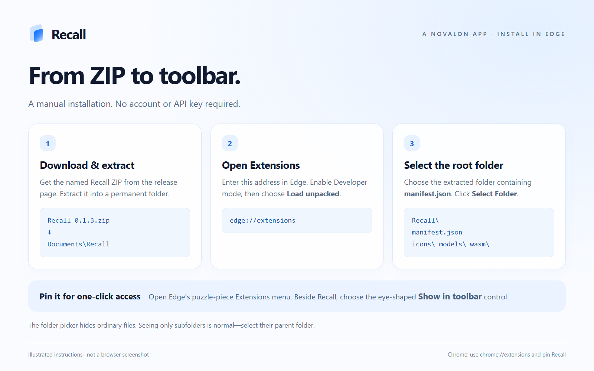
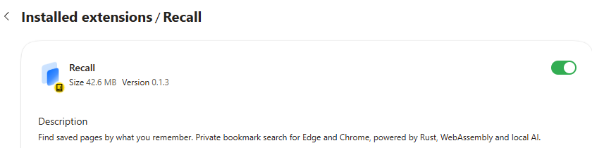
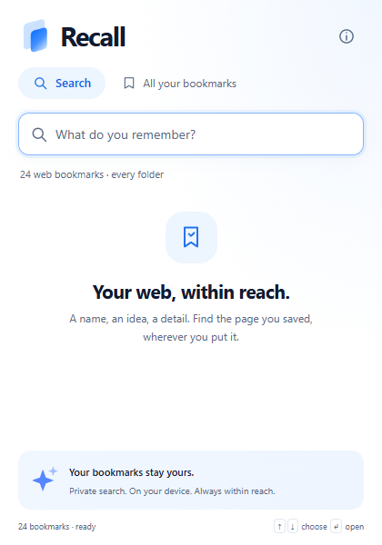
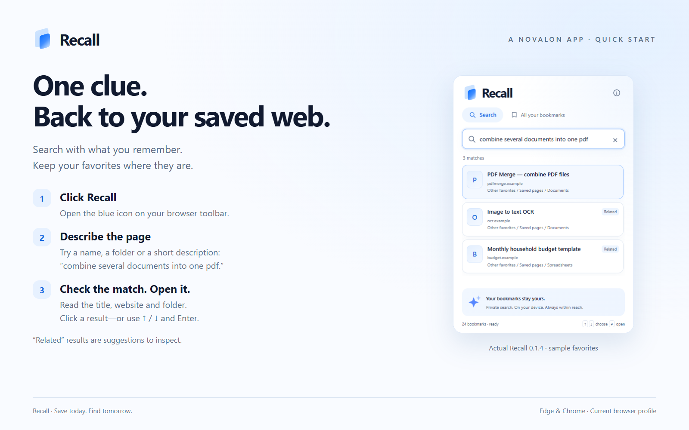
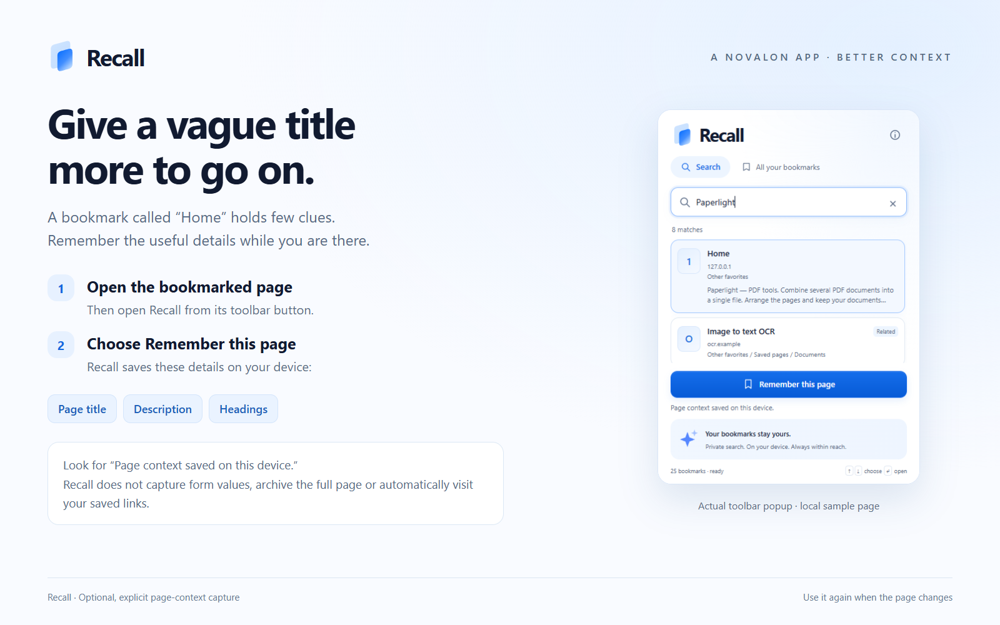

# Recall · Getting started

**A Novalon app · Guide for version 0.1.4**

Recall searches your existing browser favorites. You do not need to import them, create an account or buy an API subscription.

## 1. Download and extract

Open the [Recall 0.1.4 release](https://github.com/MiMat82/Recall-release/releases/tag/v0.1.4) and download **Recall-0.1.4.zip**. Extract the ZIP into a permanent folder—for example, `Documents\Recall`. Keep that folder after installation; the browser loads Recall from it.

Use the named Recall ZIP under **Assets**. GitHub's automatic **Source code (zip)** and **Source code (tar.gz)** downloads contain this public documentation repository, not the installable extension.

The extracted folder should contain `manifest.json`, `popup.html` and folders including `icons`, `models`, `vendor` and `wasm`. There is no installer executable to run.

## 2. Load Recall into Edge

1. Enter `edge://extensions` in Edge's address bar.
2. Enable **Developer mode**.
3. Click **Load unpacked**.
4. Navigate into the extracted Recall folder—the one containing `manifest.json`.
5. Click **Select Folder**. You should then see **Recall 0.1.4**, enabled in Edge's extension list.

**Seeing only folders in the selection dialog is normal.** That dialog hides ordinary files. If you can see `icons`, `licenses`, `models`, `vendor` and `wasm`, and you are inside the extracted extension folder, select that folder. Do not select one of its subfolders or the ZIP itself.

If your organization disables Developer mode or unpacked extensions, ask its administrator. Recall does not bypass managed-browser restrictions.

### Using Chrome instead

The same ZIP works in Chrome. Open `chrome://extensions`, enable **Developer mode**, click **Load unpacked**, and select the extracted folder containing `manifest.json`.

Edge and Chrome keep separate profiles. Installing Recall in both does not merge their favorites or Recall's saved context.

## 3. Pin the button

In **Edge**, click the puzzle-piece **Extensions** button beside the address bar. Find **Recall** and click the eye-shaped **Show in toolbar** control.

In **Chrome**, open the puzzle-piece **Extensions** menu and click the pin beside **Recall**.

The blue Recall icon now provides one-click access. You can also try **Alt+Shift+F**; if another action uses that shortcut, adjust it in your browser's extension keyboard-shortcut settings.

## 4. Open Recall and let it prepare

Click the Recall icon. Its search box receives focus automatically. Recall reads the supported web favorites in the current browser profile, including nested folders.

Text matching is available immediately. The first meaning-based index can take longer for a large collection. The status at the bottom shows progress; leave the popup open to let it continue. When ready, the status shows the bookmark count followed by **ready**.

Closing the popup stops its worker. Progress is saved after individual bookmarks, so opening it again resumes unfinished work. Nothing needs to be downloaded on first use; the model is included in the ZIP.

## 5. Search with a useful clue

Try these kinds of queries against pages you have actually saved:

| What you remember | Example |
|---|---|
| A product or site name | `Audacity` |
| A folder | `House planning` |
| What the tool does | `combine several documents into one pdf` |
| A topic | `tomato pasta` |
| Most of a name | `audactiy` |

Read the title, website and folder beneath each result. Click to open the saved URL in a new tab. Or use **↑ / ↓** to select, then **Enter** to open.

**Escape** clears a typed query. A second Escape closes the popup. The **×** inside the field clears it with the mouse.

**Related** and **Possible matches** mean “this may be relevant.” They are not certainty scores. If the list is unhelpful, use a shorter phrase, a known name, or a folder.

## 6. Improve a vague bookmark with Remember this page

1. Open the bookmarked website itself.
2. Open Recall using its toolbar button on that page.
3. Click **Remember this page**.
4. Look for **Page context saved on this device.**

The action stores the current page's title, description and headings. It does not change the bookmark, capture form fields or save the full page. The button appears only when the active supported web page is already bookmarked. Protected browser pages cannot be read.

If you previously opened Recall as a normal tab instead of through the toolbar, return to the bookmarked site and open the toolbar popup so the browser can grant temporary access for this action.

Remembered context is a local snapshot. If the page changes, use the action again to refresh it.

## 7. Update without starting over

For an existing installation:

1. Close Recall's popup.
2. Download and extract the new named Recall ZIP.
3. Copy its contents into the **same folder** your current unpacked installation uses, replacing the old files.
4. Open `edge://extensions` or `chrome://extensions` and click **Reload** on Recall.
5. Check the displayed version, then open Recall again.

**Do not uninstall as an update step.** Uninstalling removes Recall's saved page context and local index. Your native browser favorites remain, and removed context can only be restored if you previously exported a backup. Keeping the existing folder and extension identity avoids an unnecessary fresh installation.

Version 0.1.4 keeps the identity and data format used by 0.1.0, 0.1.1, 0.1.2 and 0.1.3. Keep Developer mode enabled. Unpacked installations are updated manually.

From 0.1.3 onward, open Recall → **ⓘ About** → **Check for updates** to compare with the latest public release. After replacing the files, expand **How to update without starting over** and use **Reload Recall**, or reload from the browser's Extensions page. The check neither downloads nor installs files.

See the [illustrated update guide](UPDATING.md) for the exact steps, finding your installed folder, what is preserved, and troubleshooting.

## Back up remembered context

In About, choose **Export context** to download a local JSON file containing remembered URLs and page text. Keep it private. In another Recall installation in the same browser profile, choose **Import context**. Only missing context for matching favorites is added; existing entries are retained. Favorites and cached search vectors are not included, and the index rebuilds locally.

Keep this backup before any future change of installation. GitHub is the current publishing route; there is no planned store switch. For routine updates, keep the existing folder and reload as described above.

## Where to go next

- **About:** use the small information button in Recall's header for details, permissions, licenses and download links.
- **Help:** [Troubleshooting and known limits](SUPPORT.md).
- **Privacy:** [What Recall reads and stores](PRIVACY.md).
- **Updates:** [Public release page](https://github.com/MiMat82/Recall-release/releases).

Screenshots use synthetic favorites and a local sample website, never a personal bookmark library. Windows Edge and Chrome are the currently tested installation environments.
