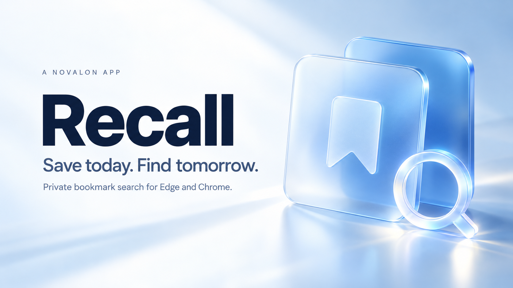
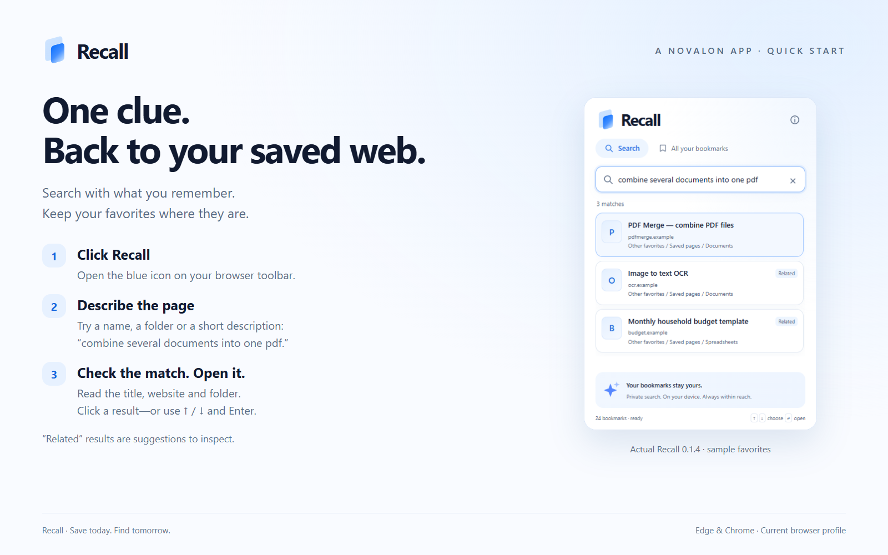
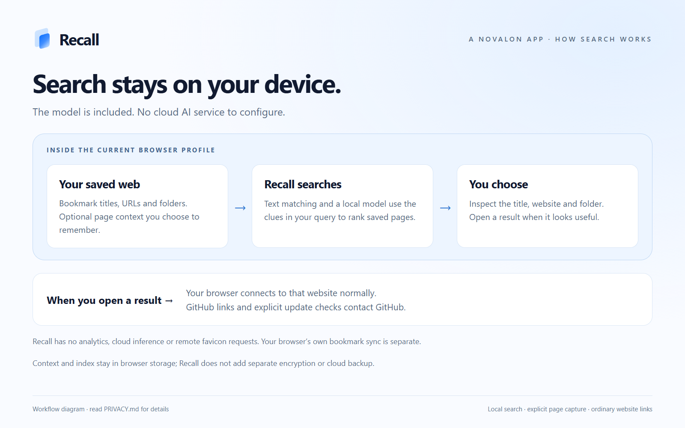
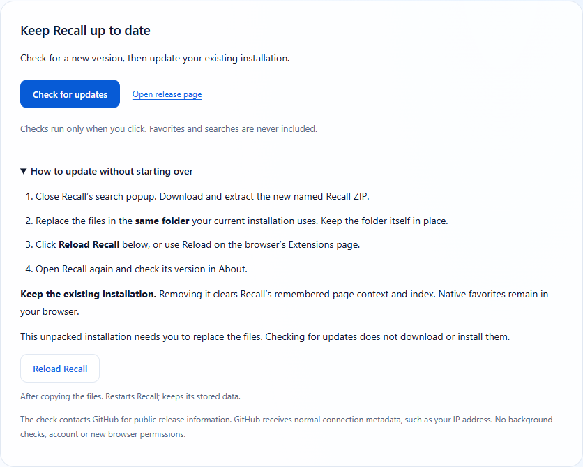

# Recall · Launch kit

**A Novalon app · Version 0.1.4 · 1 November 2026**

**Find saved pages by what you remember.**

Recall makes your existing favorites searchable right from your browser toolbar. Click. Search. Open.

**[Explore Recall](https://github.com/MiMat82/Recall-release)** · **[Download](https://github.com/MiMat82/Recall-release/releases/latest)** · **[Installation guide](GETTING-STARTED.md)**

## Launch post · LinkedIn or Facebook

You remember what the website did. You cannot remember its name—or which favorites folder you put it in.

Meet **Recall, a Novalon app**.

Click the Recall button in Edge or Chrome, type a name, a topic or a short description, and open a matching saved page. Recall searches across your existing bookmark folders, so you can keep organizing the web your own way.

Text matching and local meaning-based suggestions help you find a useful starting point. For a bookmark with an unclear title, **Remember this page** can save its title, description and headings locally to give future searches more context.

The search model is included. There is no Recall account, API key or cloud AI service to set up. Your searches and remembered context are not sent to Novalon.

Recall 0.1.4 is available on GitHub for manual installation, tested in desktop Edge and Chrome on Windows. About includes **Check for updates** and **Reload Recall**; you replace the files in the existing folder when applying a new version.

**Save today. Find tomorrow.**

Explore Recall and follow the illustrated setup guide: https://github.com/MiMat82/Recall-release

#Novalon #Recall #Productivity #Bookmarks

*Suggested image: the cover above. This is prepared copy, not a record of a social post being published.*

## Short launch post

Saved a useful page but forgot its name? Recall, a Novalon app, searches your existing Edge or Chrome favorites using words you remember. Local search. Keep your folders. Manual ZIP installation; tested on Windows. https://github.com/MiMat82/Recall-release

## Feature post · Click. Search. Open.

A useful tool is already in your favorites. Getting back to it should take fewer steps.

With **Recall by Novalon**, open the toolbar popup and try the words you still remember: a website name, a folder, or a description such as “combine several documents into one pdf.” Inspect the title, website and folder, then click a result to open it.

Your favorites stay in the browser. Local meaning search can add related suggestions; those are clues to check, not guaranteed matches. It works best in English.

Try Recall in desktop Edge or Chrome on Windows. Manual installation guide and download: https://github.com/MiMat82/Recall-release

## Feature post · Your search stays local

Your favorites can reveal what you are researching, learning or planning.

**Recall, a Novalon app**, runs its search model in your browser. Searching and indexing do not send favorites, queries or remembered page context to a cloud AI service. No Recall account or API key is needed.

Opening a result still connects to that website normally. The optional **Check for updates** button contacts GitHub for release information without including your favorites or searches.

Read the privacy explanation and try the GitHub edition: https://github.com/MiMat82/Recall-release

## Feature post · Know when a new version is available

You do not need to keep searching GitHub to check your Recall version.

Open **Recall → ⓘ About → Check for updates**. When a newer version is available, follow **View version …** to the release page. Download the ZIP, replace the files in the same installation folder, then click **Reload Recall**.

Keep the existing installation: uninstalling removes Recall's remembered page context and index. Native favorites remain in your browser.

Checking is built in. File replacement is manual. The illustrated guide walks through both: https://github.com/MiMat82/Recall-release/blob/main/UPDATING.md

## Short product description

**Recall is a Novalon browser extension for finding the pages you have already saved.** Search existing Edge favorites or Chrome bookmarks by name, folder or a short description, then open a result from a focused toolbar popup. Recall combines text matching with local meaning-based suggestions and can optionally remember a bookmarked page’s title, description and headings. The search model is bundled, with no account or API key required. Available on GitHub as a manually installed ZIP, tested in desktop Edge and Chrome on Windows. Updates are checked from About and applied by replacing files in the existing folder.

## Images and accessible captions

Use the linked original files. Keep explanatory labels visible and pair images with the installation information in the post.

| Image | Use | Suggested alt text |
|---|---|---|
| [Brand cover](assets/recall-cover.png) | Main launch announcement | Recall, a Novalon app. Save today. Find tomorrow. Blue bookmark and search artwork. |
| [Search walkthrough](assets/search-walkthrough.png) | Show the three-step workflow | Actual Recall search with sample favorites beside instructions to click, search and open. |
| [Remember a page](assets/remember-walkthrough.png) | Explain optional context capture | Recall’s toolbar popup on a sample page, explaining how title, description and headings are remembered locally. |
| [Privacy diagram](assets/privacy-flow.png) | Explain local processing | Favorites and search stay on the device; opening results and explicit update checks make separate connections. |
| [Update controls](assets/recall-updates.png) | Help existing users update | About contains Check for updates, a release-page link and manual update instructions with Reload Recall. |
| [Light-mode screenshot](assets/recall-search.png) | Product review or article | Recall’s light-mode popup searches sample favorites for a PDF tool. |
| [Dark-mode screenshot](assets/recall-dark.png) | Product review or article | Recall’s dark-mode popup searches the same sample favorites. |
| [Context backup](assets/recall-context.png) | Explain portable remembered details | Recall’s About page offers Export context and Import context for a private local JSON file. |

The cover is generated brand artwork. Product screenshots show the actual extension with synthetic favorites; walkthroughs and diagrams add explanation outside the application. Images are documentation and promotional assets, not extra downloads required to install Recall.

## Publishing notes

- Use **Recall** as the product name, with **A Novalon app** as the endorsement. Do not imply an affiliation with Microsoft’s separate Windows Recall feature.
- Link to the public repository or its latest release. Keep the private development repository out of calls to action.
- State manual ZIP installation and updates. No store badge, browser-store launch promise or one-click installation claim.
- Say what is implemented: existing browser bookmarks, local suggestions, optional remembered context and explicit update checks. Do not promise perfect retrieval, cloud sync, all-language support, full-page archives or automatic summaries.
- All copy here is ready for review and reuse. Posting to a social account, contacting communities or buying advertising is a separate action.
