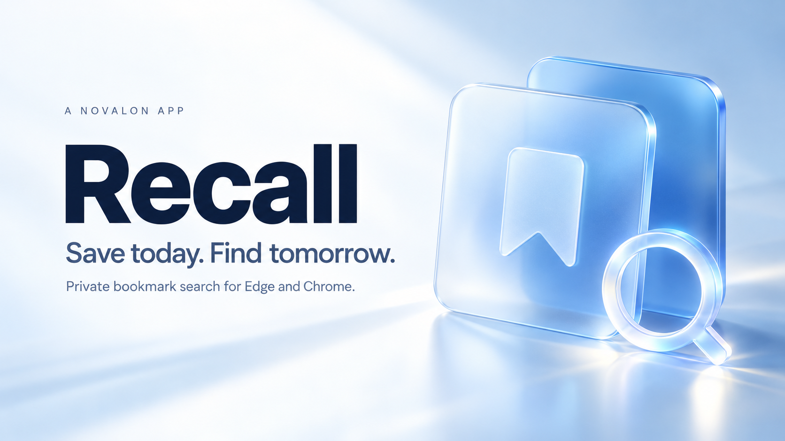
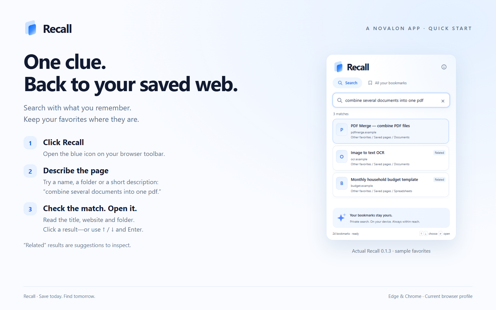
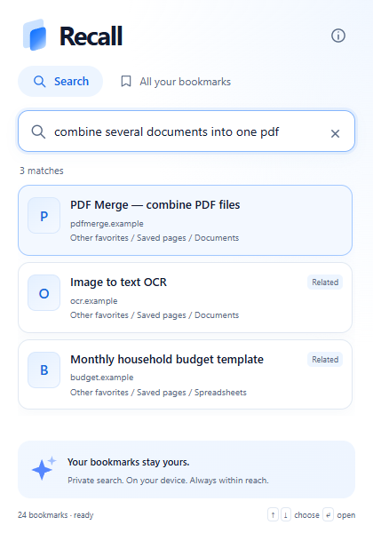
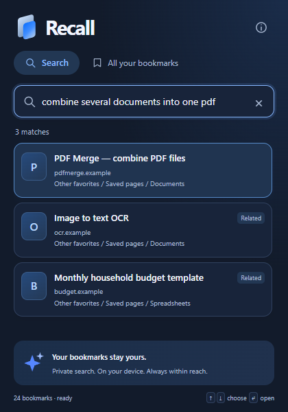
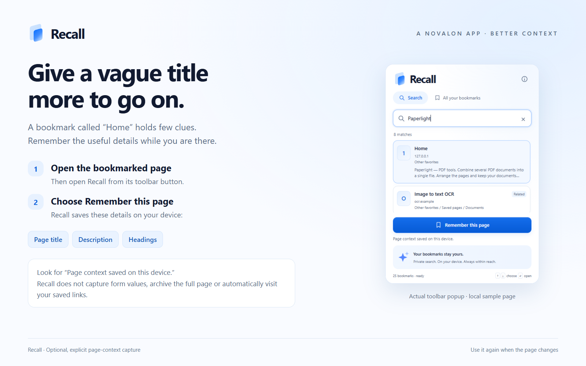
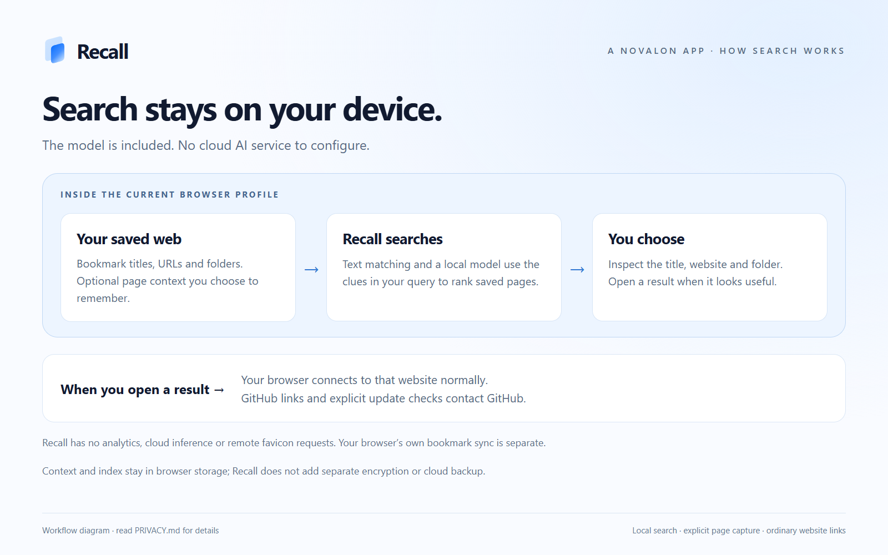

<strong>RECALL · A NOVALON APP</strong>

# Your web, within reach.

You remember finding the right tool. A useful article. A page you meant to come back to. What you cannot remember is its name—or the folder you put it in.

**Recall helps you find it again.** Click its toolbar button, type a name or describe what the page does, and open a result. It searches your existing favorites across every folder in the current browser profile, with text matching and local meaning-based suggestions.

No account. No API key. No separate application. Your favorites stay where you saved them.

**[Download Recall 0.1.3](https://github.com/MiMat82/Recall-release/releases/tag/v0.1.3)** · **[Getting started](GETTING-STARTED.md)** · **[Update safely](UPDATING.md)** · **[Privacy](PRIVACY.md)** · **[Help](SUPPORT.md)**

> Available as a ZIP you load into Microsoft Edge or Google Chrome. This is an early desktop release, tested on Windows; it is not currently listed in either browser's extension store. The download is approximately 22.3 MB because the local search model is included.

## Less hunting. More returning to what matters.

| What you need | What Recall does | Why it helps |
|---|---|---|
| Find a page without remembering its exact name | Combines text matching, typo tolerance and local meaning search | Search with the detail you still remember |
| Search a scattered collection | Looks across your existing bookmark folders | Keep organizing favorites your own way |
| Get back to a useful website quickly | A focused popup with clickable results and keyboard navigation | Click, search, open—without a separate dashboard |
| Find a bookmark with an unhelpful title | Optionally remembers the page title, description and headings | Gives Recall more useful context to search |
| Keep searches off a cloud service | Runs the bundled search model on your device | No cloud AI calls, analytics or search-account signup |

## Click. Search. Open.

1. **Click Recall.** Pin its blue icon to your browser toolbar so it is always within reach.
2. **Search with what you remember.** Try a name, a folder, a few words, or a short description such as “combine several documents into one pdf.”
3. **Open the page.** Click a result, or use the arrow keys and Enter. The saved link opens in a new tab.

Text results appear first. Meaning search can add useful suggestions once the local index is ready. Results labeled **Related**, or grouped under **Possible matches**, are suggestions to inspect—not guarantees that Recall found the right page.

## Built around the favorites you already have

Recall reads the browser's native web bookmarks. There is no migration, duplicate collection or new filing system to maintain. Favorites you create, rename, move or remove in the browser are reflected in Recall.

Use Edge favorites or Chrome bookmarks as usual. Recall adds a way to retrieve them.

  
  

*Actual Recall 0.1.3 screenshots with synthetic favorites. The interface follows your browser's light or dark appearance.*

## Give an unclear bookmark a little more context

A bookmark named “Home” tells you very little. When you are on that bookmarked web page, open Recall from the toolbar and choose **Remember this page**.

Recall saves the page's title, description and headings locally. It can then use those details to help retrieve the page later. It does not read form values or save a full copy of the page, and it does not automatically visit every link in your favorites.

## Private by design, practical by choice

The search engine, model and runtime ship with Recall. Searches, remembered page context and the search index stay in the current browser profile. There are no remote favicon requests, analytics, cloud inference calls or first-run model downloads.

Opening a result connects to that website normally. Following the GitHub links opens GitHub. Your browser may separately sync its native bookmarks according to your browser settings; Recall's context and search index do not sync through Recall.

**Check for updates**, in About, contacts GitHub only when clicked. It sends no favorites, search queries or page context. GitHub receives normal connection metadata, such as your IP address.

Read the [privacy and permissions explanation](PRIVACY.md) for exactly what is stored and what each permission is used for.

## What is included today

- Search across all supported web favorites in the current profile.
- Text, prefix, accent-normalized and typo-tolerant matching.
- Local meaning-based suggestions, with an English-focused bundled model.
- Optional **Remember this page** context capture.
- Light and dark themes, keyboard selection and a clear one-button entry point.
- An index that saves progress and resumes when you next open Recall.
- An on-demand update check, clear in-place update instructions and a Reload Recall button.
- A Rust search core compiled to WebAssembly, with a small native HTML/CSS/JavaScript interface.

Recall does **not** currently search browsing history, Edge Collections, another browser's profile, saved posts inside services such as Pinterest, or the full contents of every bookmarked page. File links and bookmarklets are excluded. It is not a page-archiving or bookmark-sync service.

## Getting started

Download **Recall-0.1.3.zip** from the [release page](https://github.com/MiMat82/Recall-release/releases/tag/v0.1.3), extract it to a permanent folder, then choose **Load unpacked** in your browser's Extensions page. Select the extracted folder containing `manifest.json`.

The [illustrated guide](GETTING-STARTED.md) covers Edge and Chrome installation, pinning, first search, remembering a page and safe updates. Keep the extracted folder in place after installation.

Already installed? [Update the existing folder and reload](UPDATING.md). Do not uninstall: that removes Recall's remembered context. Version 0.1.3 adds **About → Check for updates**; downloading and replacing the files remains manual.

## Tested—and clear about the limits

The extension has been exercised in installed Edge and Chrome on Windows using isolated profiles and sample favorites. Checks cover offline indexing and search, changing bookmarks, keyboard and click opening, real toolbar access, page-context capture, cached reopen and automated accessibility checks. The packaged download is loaded and checked separately.

Search accuracy depends on the information available about a bookmark. A vague title and URL may not contain enough clues. Meaning search works best in English and can return weak suggestions. These checks do not establish perfect personal-library search, all-language support, browser-store approval, or compatibility with every enterprise policy.

See [release notes](CHANGELOG.md) and [support](SUPPORT.md) for the current scope.

## Part of Novalon

**Recall is a Novalon app**, built around a simple idea: useful software should help you get back to what matters with less friction. Recall's role is to make the web you have already saved easier to reach.

Explore [more Novalon projects and public app repositories](https://github.com/MiMat82?tab=repositories&type=public).

This repository contains public releases, product information and user guidance. Development is maintained separately. Third-party notices and applicable software licenses are included in the extension and available from **About → Third-party licenses and attribution**.

*The cover is generated brand artwork. Product screenshots are captured from Recall with sample data; diagrams and callouts explain the workflow and are not additional application screens.*
