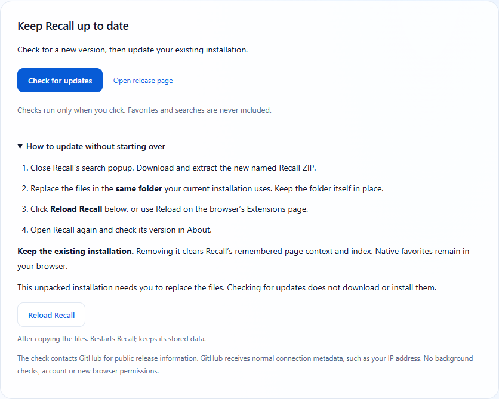

# Recall · Update without starting over

**A Novalon app · Version 0.1.4**

Keep your existing Recall installation and replace its files in place. This preserves the extension identity and its browser-profile storage. Your native favorites stay in Edge or Chrome; Recall does not move or rewrite them.

## If you already use an earlier version

1. Close Recall's search popup.
2. Download **Recall-0.1.4.zip** from the [0.1.4 release](https://github.com/MiMat82/Recall-release/releases/tag/v0.1.4). Extract it into a temporary folder.
3. Open `edge://extensions` (or `chrome://extensions`). Find Recall and open **Details**. Note the **Loaded from** folder; this is the folder to update.
4. Copy the extracted ZIP's **contents** into that existing folder, replacing the old files. `manifest.json` must stay directly inside it. Do not create an extra nested Recall folder.
5. Keep **Developer mode** enabled. Click **Reload** on Recall's extension card, or the reload control on its Details page. If it is not visible, return to the main Extensions page.
6. Open Recall, click the small **ⓘ** information button in its header, and check that About shows **Version 0.1.4**.

If the files in your installed folder have already been updated, only the reload and version check are needed. Reload reads that folder; it does not download a new version.

**Do not click Remove or uninstall Recall to update.** Uninstalling deletes Recall's remembered page context and cached index. Native browser favorites remain, but those do not contain Recall's extra remembered context. Version 0.1.4 adds **Export context** and **Import context** in About. There is no cloud backup.

## For the next update: use About

1. Open Recall → **ⓘ About** → **Check for updates**.
2. Recall compares your installed version with the latest public GitHub release. If a newer version is available, follow **View version …** to its download page.
3. Download and extract the named Recall ZIP. Close the search popup and replace the files in the **same installed folder**, as described above.
4. In About, expand **How to update without starting over** and click **Reload Recall**. Or use Reload on the browser's Extensions page.
5. Open Recall again and confirm the new version.

The check also distinguishes an up-to-date installation, a local build newer than the public release, and a failed check. A network error or GitHub rate limit does not mean your installed version is current; use the release-page link or try again later.

## What stays in place

| Item | With an in-place update to 0.1.4 |
|---|---|
| Browser favorites and folders | Remain in the same browser profile |
| Remembered page context | Retained in Recall's existing local storage |
| Cached search index | Retained; changed bookmarks may still need reindexing |
| Extension ID | Unchanged |
| Browser permissions | No additions |

In-place upgrades from 0.1.1 → 0.1.2 → 0.1.3 → 0.1.4 and the new Reload Recall button were exercised in installed Edge and Chrome on Windows, using isolated profiles. The same fixture favorite, remembered context, vector and extension ID survived each reload. This does not cover damaged profiles, uninstalling, or moving between profiles.

## Checking is built in; installation is manual

The current ZIP is an **unpacked extension**. Check for updates does not download files or install them, and Reload Recall only reloads files already on disk. Browser-store distribution would provide the normal automatic-update route; Recall is not yet listed in Edge Add-ons or the Chrome Web Store. See [Microsoft's sideloading guidance](https://learn.microsoft.com/en-us/microsoft-edge/extensions-chromium/getting-started/extension-sideloading) and [Chrome's distribution options](https://developer.chrome.com/docs/extensions/how-to/distribute).

Checks run only when you click. They request public release information from GitHub without sending your favorites, searches or page context. GitHub receives normal connection metadata, such as your IP address. No account, background checker or additional browser permission is required. [Privacy details](PRIVACY.md).

## Automatic updates through Edge Add-ons

A separate store edition has been prepared, but publisher registration and Microsoft review are pending. Once the verified listing is live and installed, Edge will handle its updates. Switching may change the extension ID: export context first and verify it in the new installation before removing the old one. [Store status and migration steps](EDGE-ADDONS.md).

## If the version does not change

Check **Loaded from** again: replacing another copy of Recall does not update the installed one. Confirm that its `manifest.json` contains the new version, and that the extracted files were copied into the root rather than a nested folder. Keep Developer mode enabled and reload. For a missing or damaged file, copy the complete package again. Do not use uninstall as a troubleshooting shortcut if you want to keep remembered context.

[Download releases](https://github.com/MiMat82/Recall-release/releases) · [Getting started](GETTING-STARTED.md) · [Help](SUPPORT.md)
