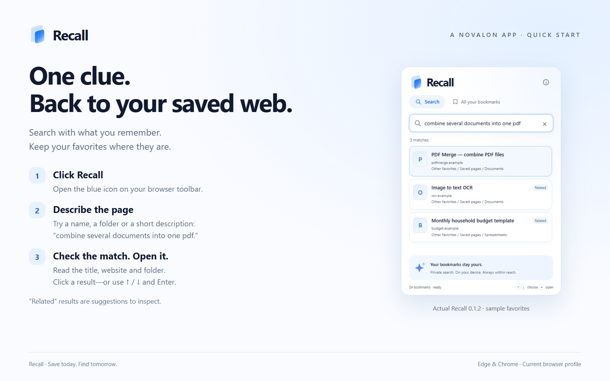

# Recall 0.1.2 · A Novalon app

Find the useful page you saved, even when its exact name escapes you. Recall brings a focused search popup to Edge and Chrome, combining ordinary text matching with local meaning-based suggestions across your existing favorites.

**Click the button. Search with a clue. Open a result.** No account, API key or separate application is required.

## Download and install

Download **Recall-0.1.2.zip** below. Extract it into a permanent folder. Open `edge://extensions` or `chrome://extensions`, enable **Developer mode**, choose **Load unpacked**, and select the extracted folder containing `manifest.json`.

If the folder picker shows only subfolders, that is normal: it hides ordinary files. Choose the root extension folder, not `icons`, `models` or another subfolder.

**[Read the illustrated guide for this version](https://github.com/MiMat82/Recall-release/blob/v0.1.2/GETTING-STARTED.md)** · **[Explore the product](https://github.com/MiMat82/Recall-release/tree/v0.1.2)** · **[Privacy](https://github.com/MiMat82/Recall-release/blob/v0.1.2/PRIVACY.md)**

GitHub's automatic **Source code** archives contain the public documentation, not the installable extension. Use the named Recall ZIP.



## What this release includes

- Private search across existing web favorites in the current browser profile.
- Text, prefix, typo-tolerant and local meaning-based matching.
- Optional **Remember this page** capture of title, description and headings.
- Light/dark themes, keyboard navigation and resumable indexing.
- The Novalon parent-brand credit and public downloads/update links.
- A full illustrated guide, product presentation, support and privacy information.

## Updating an existing local build

Close Recall, replace the files in its current installation folder with the extracted update, then click **Reload** on the browser's Extensions page. The identity and storage format are unchanged from 0.1.0/0.1.1.

Do not uninstall to update: uninstalling clears Recall's saved page context and index. Your native favorites remain intact. Unpacked updates are manual.

## Verification and limits

Five Rust tests, JavaScript boundary checks, 26 acceptance checks per browser and exact-package checks passed in installed Edge and Chrome on Windows, using isolated profiles and sample data. About passed automated light/dark accessibility checks and a narrow-viewport layout check.

Meaning search is English-focused and can return weak suggestions; inspect results labeled Related or Possible matches. Recall does not search browsing history, Edge Collections, other profiles or saves inside other services. Other platforms, personal-library accuracy and human screen-reader use are not yet broadly qualified. This is a manually installed desktop release, not a browser-store listing.

Package: **22,290,315 bytes** (approximately 22.3 MB). The local model/runtime account for most of the download. The companion `.sha256` file contains:

```text
4747a6a79522e740b1d51b09a64e8325261a4d5eb13b20624db0afffab77dcf9  Recall-0.1.2.zip
```

The cover is generated brand artwork. Product screenshots use synthetic favorites; the diagrams are explanatory illustrations. The full [release history](https://github.com/MiMat82/Recall-release/blob/v0.1.2/CHANGELOG.md) and [help page](https://github.com/MiMat82/Recall-release/blob/v0.1.2/SUPPORT.md) are included in this versioned repository.
