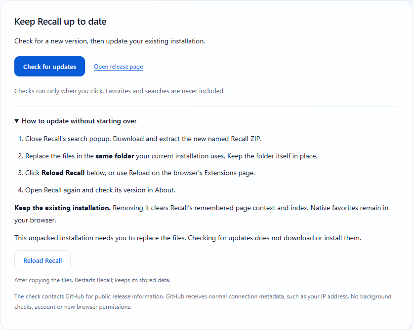

# Recall 0.1.3 · A Novalon app

**Know when a new version is ready. Keep the favorites and context you already have.**

This release adds **Check for updates** and **Reload Recall** to About, with instructions for updating your existing installation in place. It includes all of 0.1.2's Novalon branding and public release links.



## Update your existing Recall

1. Download **Recall-0.1.3.zip** below and extract it.
2. Close Recall's search popup. Copy the extracted contents into the **same folder** your installed Recall uses, replacing its old files. Do not nest another folder inside it.
3. Keep Developer mode enabled. Open `edge://extensions` or `chrome://extensions` and click **Reload** on Recall.
4. Open Recall → **ⓘ About** and confirm **Version 0.1.3**.

If that installed folder already contains the updated files, just reload. **Do not uninstall:** removal clears Recall's remembered page context and local index. Native favorites remain in the browser, but they do not contain Recall's added context.

**[Illustrated update guide](https://github.com/MiMat82/Recall-release/blob/v0.1.3/UPDATING.md)** · **[First installation](https://github.com/MiMat82/Recall-release/blob/v0.1.3/GETTING-STARTED.md)** · **[Privacy](https://github.com/MiMat82/Recall-release/blob/v0.1.3/PRIVACY.md)**

Use the named Recall ZIP under Assets. GitHub's automatic Source code archives contain public documentation, not the installable add-on.

## What's new

- **Check for updates:** compares your installed version with the latest complete public release and links to its download page.
- **Clear status:** distinguishes a new release, an up-to-date version, a newer local build, connection problems and GitHub rate limits.
- **Reload Recall:** restarts the extension after you replace its files; it does not remove the installation or its stored data.
- **In-place instructions:** explains which folder to replace, how to reload and why you should avoid uninstalling.

Checks run only when clicked. They send no favorites, search queries or remembered page context. GitHub receives normal connection metadata, such as your IP address. There are no added browser permissions, background checks or automatic downloads.

**Installation remains manual.** This is an unpacked ZIP release, not a browser-store listing. The check does not replace files, and Reload Recall only loads the files already on disk.

## Verification

- In-place 0.1.1 → 0.1.2 → 0.1.3 upgrades preserved the exact sample favorite, remembered context, cached vector and extension ID in isolated Edge and Chrome profiles. The new reload button passed the same preservation check.
- Live anonymous GitHub checks worked in both browsers without host permissions. Tests also covered malformed/incomplete releases, rate limits, disconnected checks and version comparisons.
- Five Rust tests, JavaScript boundary checks and 26 existing browser acceptance checks per browser passed. The exact extracted ZIP loaded and searched offline in both installed browsers.
- About and the expanded update panel passed automated light/dark accessibility and narrow-layout checks.

The search engine, stored-data format and extension identity are unchanged. Tests use synthetic data in installed Edge and Chrome on Windows; personal-profile behavior, store installation and other operating systems were not tested. Meaning search remains English-focused and can return weak suggestions.

Package: **22,293,034 bytes** (approximately 22.3 MB). SHA-256:

```text
f877715f5ecd26664780447442c340da2aa9f22cb801982032a8d886fb284d11  Recall-0.1.3.zip
```

[Product presentation](https://github.com/MiMat82/Recall-release/tree/v0.1.3) · [Help](https://github.com/MiMat82/Recall-release/blob/v0.1.3/SUPPORT.md) · [Release history](https://github.com/MiMat82/Recall-release/blob/v0.1.3/CHANGELOG.md)
