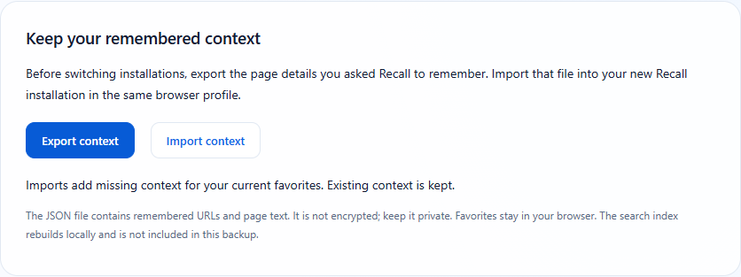

# Recall 0.1.4 · A Novalon app

**Find your saved pages. Keep the details you remembered.**

Recall brings private bookmark search to your Edge or Chrome toolbar. Search a name, a folder or a short description, then open a saved page. Version 0.1.4 adds local context export/import so you can keep the page details you asked Recall to remember.

**Available through GitHub.** The planned Edge Add-ons enrollment has been discontinued. Installation and file replacement are manual; About already includes **Check for updates**, a release-page link and **Reload Recall**. This publishing update does not change the download or its checksum.



## Update the existing installation

Download **Recall-0.1.4.zip** below, extract it and copy its contents into the **same folder** your current unpacked Recall uses. Close the search popup and click **Reload** on Recall in `edge://extensions` or `chrome://extensions`. Keep Developer mode enabled.

If that folder is already updated, just reload. Do not remove/reinstall Recall as an update step. The GitHub edition retains the existing extension identity and storage format.

**[Update guide](https://github.com/MiMat82/Recall-release/blob/main/UPDATING.md)** · **[First installation](https://github.com/MiMat82/Recall-release/blob/main/GETTING-STARTED.md)** · **[Privacy](https://github.com/MiMat82/Recall-release/blob/main/PRIVACY.md)**

Use the named Recall ZIP under Assets. GitHub's automatic Source code archives contain documentation, not the installable add-on.

## Export and import remembered context

- Open **ⓘ About → Export context** to create a local JSON backup of remembered URLs and page details.
- Keep that file private: it is not encrypted and can contain sensitive text.
- In another Recall installation in the same browser profile, choose **Import context** and select the file.
- Import adds missing context for matching favorites, keeps existing entries and reports skipped URLs. The local search index rebuilds when you reopen search.

Favorites stay in the browser. The backup contains remembered context, not all favorites or cached vectors. Invalid files are rejected without partial writes, and a failed storage transaction rolls back its changes.

## Updates from inside Recall

Open **ⓘ About → Check for updates**. If a newer complete public release is available, **View version …** opens its download page. The check runs only when clicked and sends no favorites, queries or remembered context to GitHub.

Download and extract the named Recall ZIP, replace files in the same installed folder, then use **Reload Recall**. Reload reads files already on disk; it does not download or install them. Keep your existing installation to retain its context and index.

**[Illustrated update instructions](https://github.com/MiMat82/Recall-release/blob/main/UPDATING.md)**

## Verification

- Five Rust tests and JavaScript boundary checks passed.
- Twenty-six existing browser acceptance checks passed in each of installed Edge and Chrome on Windows.
- In-place upgrades through 0.1.4 preserved fixture favorites, remembered context, cached vectors and extension ID.
- Seven migration checks per browser covered a real export download, a second extension ID, non-destructive import, malformed files, rollback, offline search and accessible controls.
- The exact GitHub ZIP loaded and searched offline in both browsers. The exact store submission ZIP was also loaded unpacked for migration/code checks.

Microsoft review, signed store installation and actual automatic delivery have not been tested. Tests used isolated profiles and synthetic data. Meaning search remains English-focused and can return weak related suggestions.

Package: **22,295,075 bytes** (approximately 22.3 MB). SHA-256:

```text
aa220e2e354a0930c315c14cdb15cdc2e2b0853f88e9863a2fe49b47eacf3c4b  Recall-0.1.4.zip
```

[Product presentation](https://github.com/MiMat82/Recall-release) · [Launch kit](https://github.com/MiMat82/Recall-release/blob/main/MARKETING.md) · [Help](https://github.com/MiMat82/Recall-release/blob/main/SUPPORT.md) · [Release history](https://github.com/MiMat82/Recall-release/blob/main/CHANGELOG.md)
